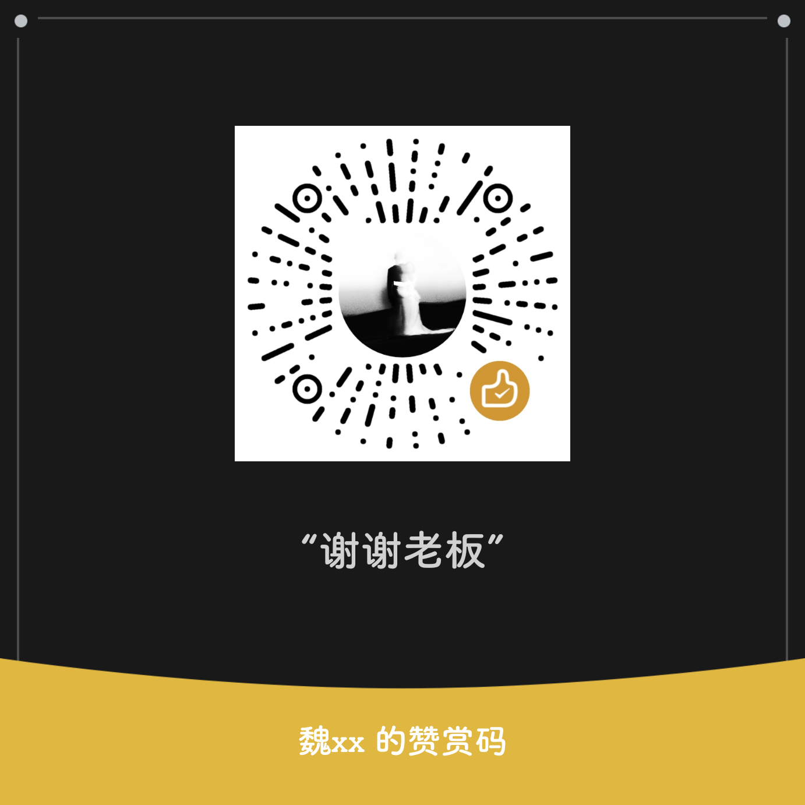

# FusionStatusBar

面向 MIUI / HyperOS 的 LibXposed 模块，提供融合状态栏、控制中心布局与外观编辑，以及桌面手势和系统界面扩展。

[下载正式版](https://github.com/yudigaga/FusionStatusBar/releases/tag/v0.5.27) · [LSPosed 下载](https://github.com/Xposed-Modules-Repo/io.github.yudigaga.fusionstatusbar/releases/tag/241-0.5.27) · [本版更新](docs/release-notes-v0.5.27.md) · [文档导航](docs/README.md)

## 当前版本

**0.5.27（构建号 241）· R8**

- “杂项 → 扫描与确认 → 隐藏首页风险提醒”默认关闭。开启后，手机管家首页的危险/风险结论、顶部及下方“正在体检”提示隐藏，病毒扫描与优化加速卡片使用普通说明、颜色并隐藏红点。
- 仅调整指定首页显示，扫描、优化、真实评分及风险数据仍由宿主维护；关闭后恢复原生显示。该开关与“666”显示选项独立。
- 新增部分仅适配 `com.miui.securitycenter` **13.8.0-261020.0.1 / 40001380** 的普通手机版首页；Lite、Pad、Fold 及结果页不在此次新增范围。

当前归档包含 32 项相关 Release 测试、完整 lint 和 R8 构建验证，未重复全量测试或进行实机验收。具体签名、哈希及验证范围见[更新说明](docs/release-notes-v0.5.27.md)。

## 主要功能

- 融合图标、双排状态栏、时钟天气、遥测和充电图标显示。
- 控制中心画布、分组、磁贴、音乐卡片、布局及材质编辑，草稿与正式配置分开保存。
- 电源菜单、音量菜单、通知中心与悬浮通知外观设置。
- 桌面手势、返回停顿及系统动作、应用和快捷方式选择。
- 可选截图剪贴板保护、链式启动确认与指定版本手机管家扩展。
- 应用界面支持跟随系统，以及简体中文、繁體中文、English、日本語、한국어、Русский、Español；切换时保护设置保存与未推送草稿。

功能是否可用取决于宿主版本、ROM 与设备能力。入口或显示调整不会增加硬件能力；当前高光玻璃尚未完成目标 ROM 的真实折射和视觉验收。

## 安装与启用

需要 Android 13（API 33）及以上，以及支持 LibXposed API 102 的框架。最低 API 不代表所有 ROM 均已验证。

1. 从上方正式发布页下载 APK，使用原正式证书覆盖更新。
2. 在 LSPosed 启用模块，按所用功能核对作用域：`system`、`com.android.systemui`、`miui.systemui.plugin`、`com.miui.home`、`com.miui.securitycenter`。
3. 首次启用或补选 System（system_server）作用域后整机重启，再打开模块确认连接状态。
4. 本版首页提醒功能需开启对应开关，并重启手机管家进程加载新 Hook；仅重启 SystemUI 不会重载手机管家。

从旧包名 `com.xtjm.fusionstatusbar` 迁移时，先在旧版导出备份，再安装 `io.github.yudigaga.fusionstatusbar` 并导入；关闭旧模块后启用新版，避免同时加载两套 Hook。升级细节见[作用域与迁移说明](docs/release-notes-v0.3.197.md)。

## 配置与恢复

- 控制中心保存草稿不会自动推送正式配置；设置写入、宿主读取和功能应用分别记录。
- 保存失败时保留上一份正式配置与当前草稿；降级前先导出备份，旧版未必认识新配置。
- 关闭自定义时恢复模块实际改动的原生状态，避免覆盖宿主后续刷新。

## 文档与开发

- [本版更新与验包记录](docs/release-notes-v0.5.27.md)
- [构建、签名与发布约定](docs/building.md)
- [模块关系与维护](docs/development.md)
- [功能说明、历史版本与技术报告](docs/README.md)
- [问题反馈](https://github.com/yudigaga/FusionStatusBar/issues)：请提供模块版本、ROM、宿主版本、作用域、复现步骤及脱敏日志。

## 开源组件

- [Miuix](https://github.com/compose-miuix-ui/miuix) 0.8.8，Apache-2.0；设置页使用 Compose/Miuix，预览与画布复用 View/Compose 互操作。
- MaterialKolor 4.1.1；[来源与许可](third_party/materialkolor/NOTICE)随源码和 APK 保留。
- [图标资源来源与许可](third_party/material-icons/README.md)。

## 赞助

如果你喜欢这个项目，欢迎请我喝杯咖啡 ☕

