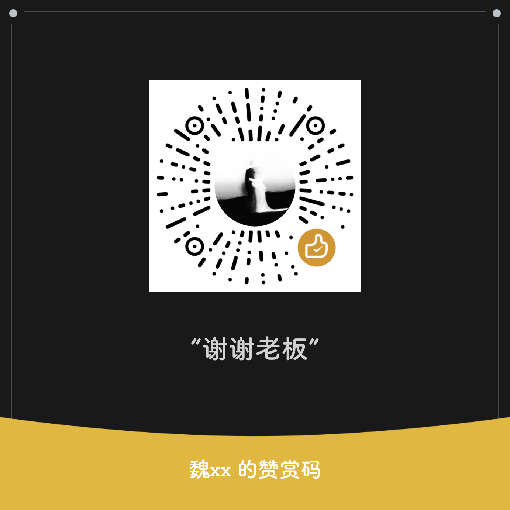

  

# FusionStatusBar

[下载正式版](https://github.com/yudigaga/FusionStatusBar/releases/tag/v0.5.36) · [LSPosed 下载](https://github.com/Xposed-Modules-Repo/io.github.yudigaga.fusionstatusbar/releases/tag/250-0.5.36) · [本版说明](docs/release-notes-v0.5.36.md) · [文档目录](docs/README.md)

面向 MIUI / HyperOS 的 LibXposed 模块，提供融合状态栏、控制中心布局与材质编辑，以及桌面手势和系统界面扩展。

## 当前版本

**0.5.36（构建号 250）· R8**

- 仅在原生闹钟图标因空间不足而完全淡出后，让双排网速回收释放的空间。
- 隐私提示退出时，按原生图标的最终位置恢复双排网速布局；原生图标仍由系统布局。
- 沿用 0.5.34 后续的控制中心模糊恢复修复。本版未新增作用域。

## 主要功能

- 融合图标、双排状态栏、时钟天气、遥测、状态图标显示及充电图标设置。
- 控制中心画布、分组、磁贴、音乐卡片、布局与材质编辑，草稿和正式配置分开保存。
- 电源菜单、音量菜单、通知中心与悬浮通知外观设置。
- 桌面手势、返回停顿及系统动作、应用和快捷方式选择。
- 可选截图剪贴板保护、链式启动确认与指定版本手机管家扩展。
- 应用界面支持跟随系统，以及简体中文、繁體中文、English、日本語、한국어、Русский、Español。

功能受宿主版本、ROM 和设备能力影响。最低 Android 版本不代表所有 ROM 均已验收。

## 安装与启用

需要 Android 13（API 33）及以上，以及支持 LibXposed API 102 的框架。

1. 从上方正式发布页下载 APK，沿用原正式证书覆盖更新。
2. 在 LSPosed 启用模块并核对已有作用域：`system`、`com.android.systemui`、`miui.systemui.plugin`、`com.miui.home`、`com.miui.securitycenter`。本版未新增作用域。
3. 更新后重启 SystemUI 以加载新 Hook；首次安装或补选 System 作用域时整机重启。
4. 在“图标显示自定义”中调整 19 类状态图标。能否显示仍受宿主槽位状态与可用空间影响。

从旧包名 `com.xtjm.fusionstatusbar` 迁移时，先导出配置备份，再安装 `io.github.yudigaga.fusionstatusbar` 并导入；不要同时启用新旧两个模块。详见[作用域与迁移说明](docs/release-notes-v0.3.197.md)。

## 配置与恢复

- 配置 schema 更新为 `7`；旧配置没有图标可见性字段时使用兼容默认值。
- 保存失败时保留上一份正式配置与当前草稿；降级前先导出备份，旧版未必认识新配置。
- 关闭自定义时恢复模块实际改动的原生状态，避免覆盖宿主后续刷新。

## 文档与开发

- [本版更新与验证](docs/release-notes-v0.5.36.md)
- [构建、签名与发布](docs/building.md)
- [模块关系与维护](docs/development.md)
- [历史版本、功能说明与技术报告](docs/README.md)
- [问题反馈](https://github.com/yudigaga/FusionStatusBar/issues)

## 开源组件

- [Miuix](https://github.com/compose-miuix-ui/miuix) 0.8.8，Apache-2.0；设置页使用 Compose/Miuix，预览与画布复用 View/Compose 互操作。
- MaterialKolor 4.1.1；[来源与许可](third_party/materialkolor/NOTICE)随源码和 APK 保留。
- [图标资源来源与许可](third_party/material-icons/README.md)。

## 赞助

如果你喜欢这个项目，欢迎请我喝杯咖啡 ☕

